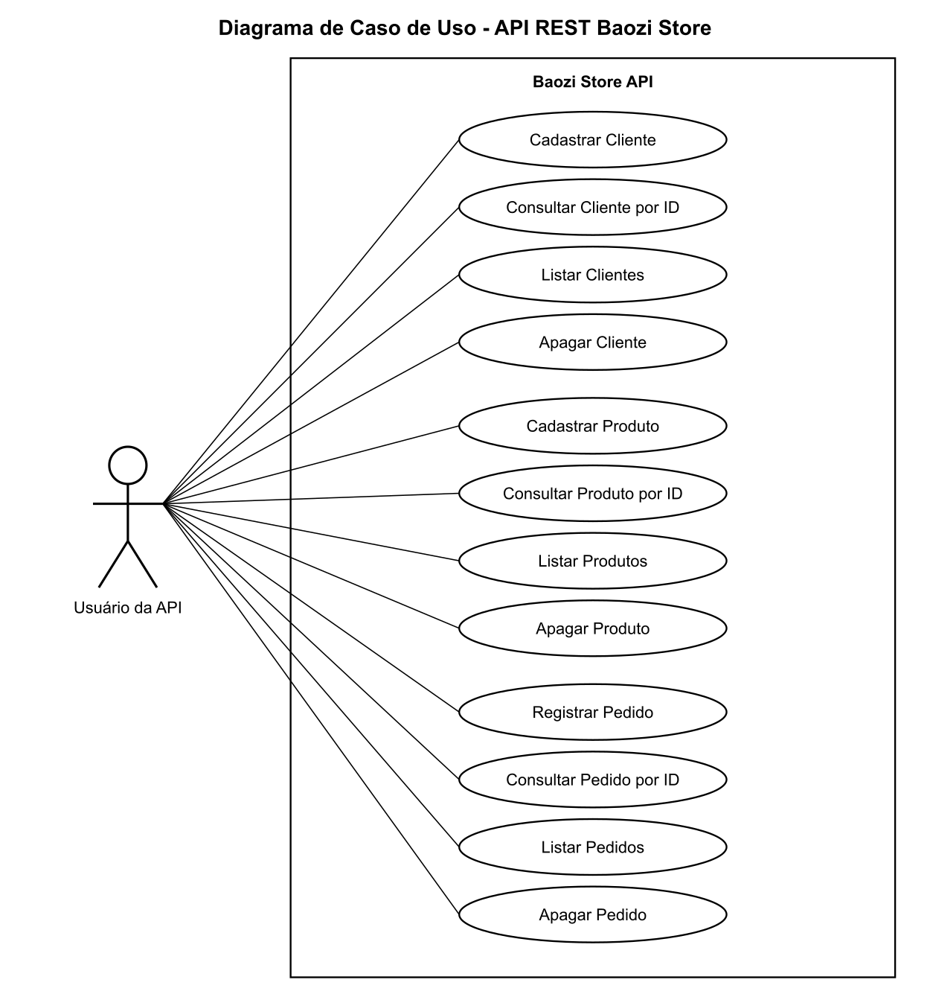

# Baozi Store - API REST

Trabalho de Desenvolvimento Web Back-End.
Stack: Java, Spring Boot 3.5, Spring Data JPA, H2 (arquivo local), JSON.

## Executar
Requer JDK 17+ e Maven. Confira se o `JAVA_HOME` aponta para esse JDK:

    mvn spring-boot:run

API em http://localhost:8080 | Console do banco: http://localhost:8080/h2-console
(JDBC URL: `jdbc:h2:file:./data/baozidb`, user `sa`, senha vazia)

## Diagrama de caso de uso

## Estrutura
- `model/` Produto, Cliente, Pedido
- `repository/` interfaces JpaRepository
- `controller/` endpoints REST

## Endpoints (Produto `/produtos`, Cliente `/clientes`, Pedido `/pedidos`)
| Metodo | Rota | Descricao |
|---|---|---|
| POST | `/{recurso}` | criar (201) |
| GET | `/{recurso}/{id}` | consultar por ID (200/404) |
| GET | `/{recurso}` | listar todos |
| DELETE | `/{recurso}/{id}` | apagar (204/404) |

## Campos
- Produto: id (Long), nome (String), preco (BigDecimal), estoque (Boolean)
- Cliente: id (Long), nome (String), clienteDesde (LocalDate, `yyyy-MM-dd`)
- Pedido: id (Long), clienteId (Long), produtoId (Long), quantidade (Integer)

## Exemplos para o Postman
No pedido, use os IDs retornados ao criar o cliente e o produto.

    POST /clientes {"nome":"SeuNomeRU","clienteDesde":"2026-11-06"}
    POST /produtos {"nome":"Baozi de Carne","preco":8.50,"estoque":true}
    POST /pedidos  {"clienteId":1,"produtoId":1,"quantidade":3}
